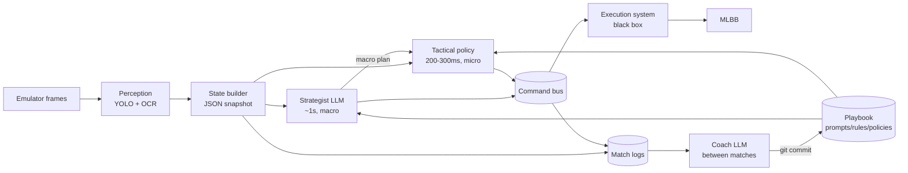

# MLBB Decision Agent

An AI that plays Mobile Legends: Bang Bang from raw pixels. A perception stack (YOLO + OCR) turns emulator frames into a compact state JSON. A two-tier decision layer — a strategist LLM for ~1s macro planning and a tactical policy for 200–300ms micro decisions — publishes high-level commands onto a bus. An execution system (kept as a black box) carries them out. Between matches, a coach LLM reviews logs and commits small, gated edits to a versioned playbook of prompts, rules, and policies.

## Status

Early stage: blueprint + capture prototype. Decision layer and training pipeline not built yet.

What is in this repo today:

- A working screen-grab loop that runs YOLO and OCR on the newest emulator frame at a fixed tick
- Pydantic contracts for `mlbb.state/v1` and `mlbb.decision/v1`

What is not here: a trained detector, a state builder that emits the full schema, a strategist or tactical loop, a command bus, an execution layer, or any training checkpoints. No benchmarks are claimed.

## Architecture



The agent decides; it does not tap. Pathing, skill aim, combos, and input timing belong to the execution system. Every decision carries a `ttl_ms`; once it expires, execution falls back to its default behavior.

## Perception

`perception/mlbb_capture.py` is the current prototype.

- Fixed tick (~15 Hz). The loop always grabs the newest frame and drops any backlog, so it never acts on stale video.
- YOLO runs on a 640 px resize of the emulator window. Box centers are projected from screen space to minimap coordinates with a fixed homography.
- PaddleOCR reads gold and timer from fixed crops.
- Snapshots older than ~150 ms are not published. Downstream layers should ignore stale state.

A fine-tuned checkpoint is required to detect MLBB heroes, towers, and the minimap. The default `yolov8n.pt` weights are a hook for local testing, not a trained MLBB model. The capture loop does not yet assemble `mlbb.state/v1` snapshots.

## State representation

Positions are normalized to `[0, 1]` on the minimap, so the schema is resolution-independent. `null` means not visible or unknown, never zero. `seq` is monotonic so a late decision can be dropped. Missing enemies plus `last_seen` are the most useful gank signal for macro play. Before a snapshot is sent to the strategist, `compact()` drops static fields, rounds floats, and prefers zone names over coordinates so the prompt stays within a few hundred tokens.

Illustrative snapshot (not recorded match data):

```json
{
  "schema": "mlbb.state/v1",
  "t": 412.6,
  "seq": 8231,
  "self": {
    "hero": "Chou",
    "role": "roam",
    "pos": [0.42, 0.61],
    "zone": "river_bot",
    "hp": 0.38,
    "mana": 0.55,
    "level": 7,
    "cd": { "s1": 0, "s2": 3.2, "ult": 18.0, "spell": 0 },
    "spell": "flicker",
    "gold": 3120,
    "alive": true
  },
  "allies": [
    {
      "hero": "Layla",
      "role": "gold",
      "pos": [0.71, 0.88],
      "zone": "lane_bot",
      "hp": 0.62,
      "level": 6,
      "ult_ready": true,
      "alive": true
    },
    {
      "hero": "Fanny",
      "role": "jungle",
      "pos": null,
      "zone": "jungle_top",
      "hp": null,
      "level": 8,
      "alive": false,
      "respawn_in": 11
    }
  ],
  "enemies_visible": [
    {
      "hero": "Franco",
      "pos": [0.50, 0.55],
      "zone": "river_bot",
      "hp": 0.80,
      "level": 7,
      "last_seen": 0.0
    }
  ],
  "enemies_missing": [
    { "hero": "Ling", "last_zone": "jungle_bot", "last_seen": 6.4 }
  ],
  "objectives": {
    "turtle": { "alive": true, "spawn_in": 0, "contested": false },
    "lord": { "alive": false, "spawn_in": 68 }
  },
  "towers": {
    "ally":  { "top": [1, 1, 1], "mid": [0, 1, 1], "bot": [1, 1, 1] },
    "enemy": { "top": [1, 1, 1], "mid": [1, 1, 1], "bot": [0, 1, 1] }
  },
  "lead": { "gold": -850, "xp": -200, "kills": [6, 8] },
  "minimap_threat": { "lane_bot": 0.7, "river_bot": 0.6, "mid": 0.2 }
}
```

| Field | Meaning |
| --- | --- |
| `t` | Game clock in seconds |
| `seq` | Monotonic snapshot id |
| `pos` | Minimap-normalized `[x, y]` in `[0, 1]` |
| `cd` | Remaining cooldown in seconds; `0` means ready |
| `towers.*` | Per-lane remaining towers as `[T1, T2, base]`; `1` = standing, `0` = destroyed |
| `lead.kills` | `[ally, enemy]` kill counts |
| `minimap_threat` | Per-zone threat estimate in `[0, 1]` |
| `null` fields | Unknown or not visible — never treat as zero |

## Decision layer

Two tiers share the same output contract (`decision/schemas.py`) and publish onto one command bus.

| Tier | Cadence | Responsibilities | Implementation (planned) |
| --- | --- | --- | --- |
| Strategist | ~1 s | Rotations, objectives, ganks, push/defend, recall | LLM, JSON response, hard guards applied after validate |
| Tactical | 200–300 ms | Engage/disengage, retreat, focus, dodge intent | Rule engine (`rules.yaml` + policies); later a small model trained from logs |

They are split because LLM latency is variable and can miss a micro window, while MOBA macro changes on a scale of seconds, so a 1 s cadence is enough. Tactical must be deterministic and fast (a few milliseconds locally). It may override the macro plan only with defensive intents (`RETREAT`, `DISENGAGE`, `DODGE`); it cannot invent new macro.

Bus priority: hard guards in the playbook beat defensive tactical, which beats the strategist, which beats execution's default. `urgency` and `ttl_ms` decide preemption. If the strategist times out or fails validation, a rule-based fallback is published instead.

Illustrative command (not a live output):

```json
{
  "schema": "mlbb.decision/v1",
  "seq": 8231,
  "tier": "strategist",
  "intent": "RETREAT",
  "target": { "type": "zone", "id": "tower_bot_t2" },
  "lane": "bot",
  "urgency": 0.85,
  "ttl_ms": 1500,
  "confidence": 0.7,
  "reasoning": "HP 38%, Ling missing 6s from jungle_bot, 2 vs 3 visible. Wait for Fanny to respawn in 11s, then contest turtle.",
  "next": { "intent": "CONTEST_OBJECTIVE", "target": "turtle", "after_s": 11 }
}
```

| Field | Meaning |
| --- | --- |
| `seq` | Snapshot this decision answers |
| `tier` | `strategist` or `tactical` |
| `intent` | Enum — macro (`FARM_LANE`, `GANK`, `FOCUS_LORD`, …) or micro (`ENGAGE`, `RETREAT`, `KITE`, …) |
| `target.type` | `hero`, `zone`, `objective`, or `tower` |
| `urgency` | `0..1`, used by execution to preempt |
| `ttl_ms` | If expired, execution reverts to default behavior |
| `next` | Optional follow-up after a delay |

## Playbook and coach

The playbook (prompts, `rules.yaml`, and small policy modules) is the only surface the coach may edit. After each match, logs are distilled into key moments (deaths, objectives, guard overrides, plus the outcome 10 s later). The coach proposes a minimal unified diff. A patch tool accepts diffs only under `playbook/`, respects a `locked` rule list, and runs tests.

A candidate is promoted only if it beats the baseline on a frozen holdout set and a scripted sim: no drop in sensible-rate beyond a tight margin, win rate at least as high, and first-death time not materially worse. Failures revert. Commits can be made per match, but live promotion happens in batches (`candidate` vs `main`) with a small diff budget so effects can be attributed. Offline tests, in order: labeled replay of recorded states, a toy 2D three-lane MOBA for the macro/coach loop, hand-crafted scenario unit tests, and shadow mode (the agent decides while a human plays, and sends no commands).

## Training plan

1. **Behavior cloning.** Record matches as frame + touch-input pairs (and the aligned state snapshots). Train a small policy that maps the last ~2 s of state to an action (move vector, skill, target).
2. **PPO fine-tune.** Wrap the emulator in a gym-style env against in-game AI bots. Reward is win/loss, with fading shaping from gold differential and tower damage, a time penalty after ~15 minutes so stalling costs more than it earns, and per-match caps on gold and tower rewards so farming a single tower stops paying out. A KL penalty toward the BC policy limits drift from how real players close games.
3. **Eval harness.** Nightly bot-match batches log win rate, match length, APM, and reaction time, and automatically roll back any checkpoint that gets worse — including runs where matches get longer while win rate stays flat (reward hacking).

## Infrastructure

The planned grid is Redroid (Android in Docker) on one rented bare-metal box, a Hetzner-class 32-core machine with one used 3090, running about 12 headless instances at low resolution. Inference and PPO share the 3090; the policy is small (~20M params). Heavy BC pretraining runs in short bursts on spot A100s, checkpointed frequently so preemption is cheap. Jobs spin up only when queued and tear down when finished. Eval matches run overnight on the same box when it is otherwise idle. A hard monthly cap pauses work if it is hit; the target is under $300/month all-in. The decision loop stays close to the emulator to keep latency low.

This is a plan, not a provisioned cluster.

## 30-day success metrics

All measured over 100 consecutive custom matches vs the in-game Hard AI, with 5 bot instances on the agent's team:

| # | Metric | Pass line |
| --- | --- | --- |
| 1 | Win rate | 60%+ pass; under 40% fail; in between, keep training |
| 2 | Median reaction (enemy on screen → skill input) | under 250 ms |
| 3 | Effective APM | 60–120 (human-like, not spam) |
| 4 | Stability | zero crashes or stuck states across all 100 matches |
| 5 | Average match length | under 18 minutes (closes games instead of farming) |

Missing #1 or #4 is a public fail. These are targets, not results.

## Roadmap

1. **Capture prototype** — this repo. Fixed-tick screen grab, YOLO, OCR.
2. **State builder** — turn each tick into a validated `mlbb.state/v1` snapshot, including missing-enemy tracking.
3. **Decision loops** — strategist + tactical policy + command bus, with hard guards and a TTL contract. First hero: Layla (long range, simple skill set, one clean vision target).
4. **Logging and offline eval** — JSONL match logs, replay labels, scenario tests, shadow mode.
5. **Learning** — behavior cloning, then PPO vs in-game bots, with the eval harness and auto rollback.
6. **Coach loop** — gated playbook edits on holdout + sim, then the 30-day evaluation above.

## Tech stack

| Layer | Choice |
| --- | --- |
| Language | Python 3.11+, asyncio, Pydantic |
| Perception | YOLO + OCR on emulator frames (`ultralytics`, PaddleOCR, `mss`) |
| Strategist | Low-latency chat model via an OpenAI-compatible API, plus a fallback model |
| Tactical | Rule engine (`rules.yaml` + policies); later a small model from logs |
| Coach | Same LLM family, or a headless coding agent over the playbook repo |
| Bus | asyncio queue locally; Redis pub/sub or ZeroMQ if execution is a separate process |
| Logs | JSONL per match, DuckDB for queries |
| Infra | Redroid grid on one bare-metal box + used 3090; spot A100 bursts for BC; hard budget cap |

If a model's p95 latency is close to 1 s from the host region, raise the strategist cadence to 1.5–2 s or shrink the prompt. Measure; don't assume.

## Repo layout

```
mlbb-capture/
├── perception/
│   └── mlbb_capture.py   # screen-grab + YOLO + OCR loop (prototype)
├── decision/
│   └── schemas.py        # GameState, Decision, Intent (Pydantic)
├── requirements.txt
└── README.md
```

Planned, not in tree yet: `playbook/` (the only folder the coach may edit), `coach/`, `sim/`, and `logs/`.

## Quick start

```bash
python -m venv .venv
source .venv/bin/activate
pip install -r requirements.txt
python perception/mlbb_capture.py --weights yolov8n.pt
```

Optional flags: `--homography path/to/3x3.json` for screen-to-minimap mapping, `--show` to preview detections. Edit `REGION` and `CROPS` in the script to match the emulator window. Validate the example schemas with `python decision/schemas.py`.

## Risks and terms of service

Moonton's terms prohibit automation, botting, and third-party software that grants an advantage. Accounts can be banned.

- Use throwaway accounts only. Never a main account, never ranked.
- Validate offline: simulation, replays, and custom rooms vs in-game AI.
- Do not modify the game client. The agent reads pixels and emits high-level commands; it does not inject into or patch the game.
- Perception errors propagate into decisions. Always carry confidence values and treat `null` as unknown.
- Without a frozen holdout and a promotion gate, a coach loop will overfit the last few matches.

## License

MIT, © 2026 Ryan Immanuel.
